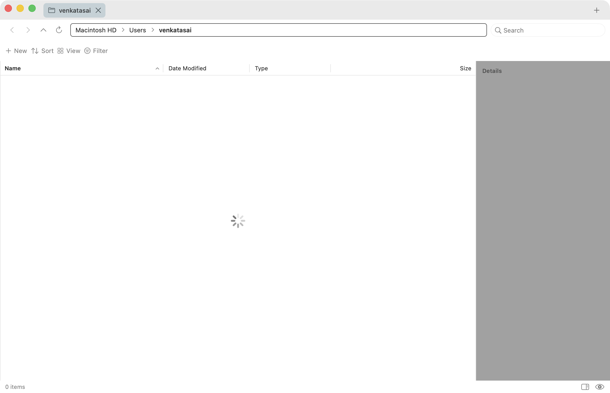

<div align="center">


# Dora the Explorer

**A native macOS file explorer with the structure of Windows 11 File Explorer — and the speed of a purpose-built AppKit app.**

Tabs, breadcrumb address bar, command bar, ID-stable selection that survives live file changes,
undoable copy/move/trash — all Swift 6 strict-concurrency, zero third-party dependencies.


[](https://github.com/vskrch/dora-the-explorer/actions/workflows/ci.yml)


</div>

---



<p align="center"><i>Details view: tabs in the transparent title bar, breadcrumb trail with subfolder menus, command bar, live-updating file list. ⌘R-style rename in progress, with the extension left untouched.</i></p>

---

## Why Dora?

Finder is a great Mac app — but if you live in **both** worlds, Windows 11's Explorer muscle memory
(navigate by breadcrumbs, manage files through one command bar, tabs that tear off, cut/paste
move semantics) never quite maps onto it. Dora brings exactly that structure to macOS, built the
way a Mac app should be built:

- **100% native AppKit.** No SwiftUI `LazyVGrid` pretending to be a file list. `NSTableView`
  with pooled cells, an O(1) row space, and 100k-item folders enumerating their first batch off
  the main thread in well under 100 ms on Apple Silicon (budget-enforced by a perf test).
- **Swift 6 strict concurrency everywhere.** Every byte of disk I/O — enumeration, sorting,
  grouping, renames, copy/move/trash — runs on an actor or a detached task. The main thread only
  renders published `Sendable` snapshots.
- **Selection that refuses to drift.** Rows are addressed by file ID, not index, so re-sorts
  and live FSEvents updates never shift what you have selected, and your scroll position is
  anchored across every change.
- **Every operation undoable.** Copy/move/trash/replace all produce typed undo records
  (`⌘Z` / `⇧⌘Z`, per window). Overwritten originals get parked in the Trash, not destroyed.
  Trashed items remember where they came from — restore works even though macOS "Put Back" is
  Finder-private.
- **Zero third-party dependencies.** Everything ships in the box, in 8 focused Swift packages.

## Feature highlights

| Area | What works today |
| --- | --- |
| **Tabs & windows** | Tabs in the title bar (context menu, tear-off to new window, ⌘T / ⌘W / ⌘⇧T / ⌃⇥ / ⌘1–9), per-window state, tabs & folders restored across launches |
| **Address bar** | Breadcrumb segments with per-level subfolder menus (async, Explorer-style), leading-segment overflow `«`, click-to-edit with `~` expansion, segment context menus |
| **Details view** | Sortable columns (click headers, name-tiebreak), grouping by Type / Date modified / Size with collapsible headers, column chooser, Size-all-to-fit, type-to-select, per-folder view memory (sort, columns, widths, grouping, hidden) |
| **Opening** | Double-click/Enter opens, ⌘-double-click & middle-click open a new tab, Backspace goes back, Delete trashes |
| **Clipboard** | Windows cut/paste semantics (cut marks items ghosted, paste moves them) that degrade to plain copy in other apps |
| **Drag & drop** | Drag rows out to anywhere; drop onto folders or the background — same-volume moves, cross-volume copies, ⌥ forces copy, ⌘ forces move |
| **File ops engine** | Copy, move, trash, undo/redo; conflicts auto-resolve keep-both (`name (2).ext`); replace parks the original in the Trash so undo restores it |
| **Inline rename** | F2 or right-click → basename preselected, extension untouched; Tab rolls rename to the next item; separators, duplicates, `.`/`..` and overlong names rejected inline — never a modal |
| **Polish** | Command bar (New / Sort / View menus under their buttons), loading/empty/error states with working Retry, glass-respecting Reduce Transparency & Increase Contrast, SF-symbol iconography, warmed UTType icon cache |

Full, honest inventory: **[FEATURES.md](FEATURES.md)** — every line checkable, nothing padded.

## Build it

**Requirements:** macOS 26+, Xcode 26, [XcodeGen](https://github.com/yonaskolb/XcodeGen) (`brew install xcodegen`).

```sh
git clone https://github.com/vskrch/dora-the-explorer.git
cd dora-the-explorer

make build        # regenerate project, Debug build into build/
make run          # build + launch
make test         # app tests + every package's tests
```

Want the fast lane? `make test-packages` runs just the package suites (~40 s, includes the
DirectoryEnumerator 100k-file perf budget test).

Xcode person? `xcodegen generate && open Dora.xcodeproj`.

## Instruction set (keyboard)

| Action | Shortcut |
| --- | --- |
| New window / New tab | `⌘N` / `⌘T` |
| Close tab · Reopen closed tab | `⌘W` · `⇧⌘T` |
| Switch tabs | `⌃⇥`, `⌃⇧⇥`, or `⌘1…⌘9` |
| Back · Forward · Up | `⌘[` · `⌘]` · `⇧⌘↑` — plus **Backspace** to go back |
| Edit the address bar | `⌘L` (Esc restores breadcrumbs) |
| Open selected | `Enter` or double-click — `⌘`-double-click opens a folder in a new tab |
| Rename | `F2` (Tab inside rename rolls to the next item, Esc cancels) |
| Move to Trash | `Delete` (Windows 11) or `⌘⌫` (macOS) |
| Cut · Copy · Paste | `⌘X` · `⌘C` · `⌘V` |
| Undo · Redo | `⌘Z` · `⇧⌘Z` |
| Select all | `⌘A` |
| Refresh | `⌘R` |
| Drop into a folder | drag rows onto a folder or the background — `⌥` copy, `⌘` move |

## Architecture

```
Dora (app) · windows · tabs · chrome · details view · menu/clipboard wiring
├─ AppCore        window/tab state, navigation history, workspace persistence
├─ FSCore         bulk enumeration (getattrlistbulk), FSEvents watcher, DirectoryModel
├─ FileOps        FileOperationEngine + TrashStore (typed undo records)
├─ DesignSystem   chrome materials + accessibility fallbacks
├─ Thumbnails     QL pipeline (in development)
├─ Search         query engine (planned)
├─ Archives       libarchive browsing (planned)
└─ ShellIntegration  services, dora:// scheme, CLI (planned)
```

The full write-up — threading model, publish flow, ID-addressed selection, perf budgets —
lives in **[docs/ARCHITECTURE.md](docs/ARCHITECTURE.md)**. [FEATURES.md](FEATURES.md) tracks the
open roadmap (icons/list/tiles views, thumbnails, search, sidebar, Quick Look, properties,
bulk rename, localization, Sparkle updates, notarization).

## Status: public beta

Dora is **daily-drivable** for browsing, tab management, and safe file operations — the engine
underneath is tested and reviewed (adversarial code reviews run per phase; findings get fixed,
not filed). Treat it as software that's still earning trust in the places a file manager must
never fail: progress UI for very large transfers, and a conflict dialog, are landing next.
Until then: it never destroys data — every path is undoable, every overwrite keeps the
original in the Trash.

## Contributing

PRs welcome. The rules that matter are in
[`.cursor/rules/project.mdc`](.cursor/rules/project.mdc) — the two non-negotiables:

1. **No disk I/O, sorting >5k items, or metadata fetch on the main thread.** Ever.
2. **`make test` must pass** — package suites plus app tests, plus your new tests for
   whatever you added.

## License

MIT — see [LICENSE](LICENSE).
